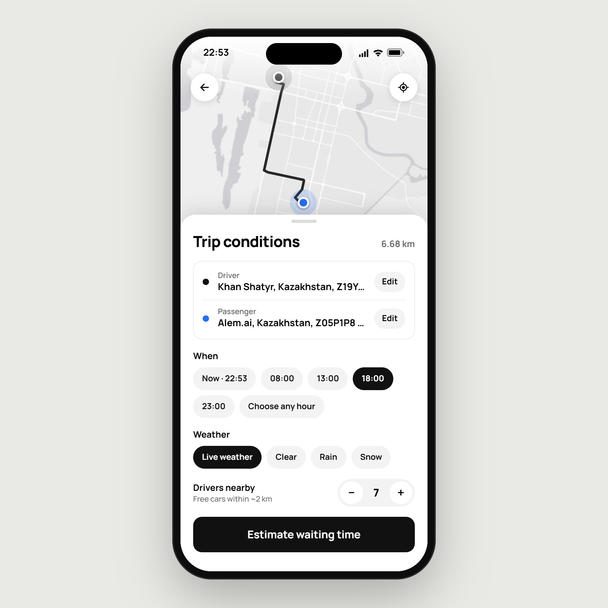
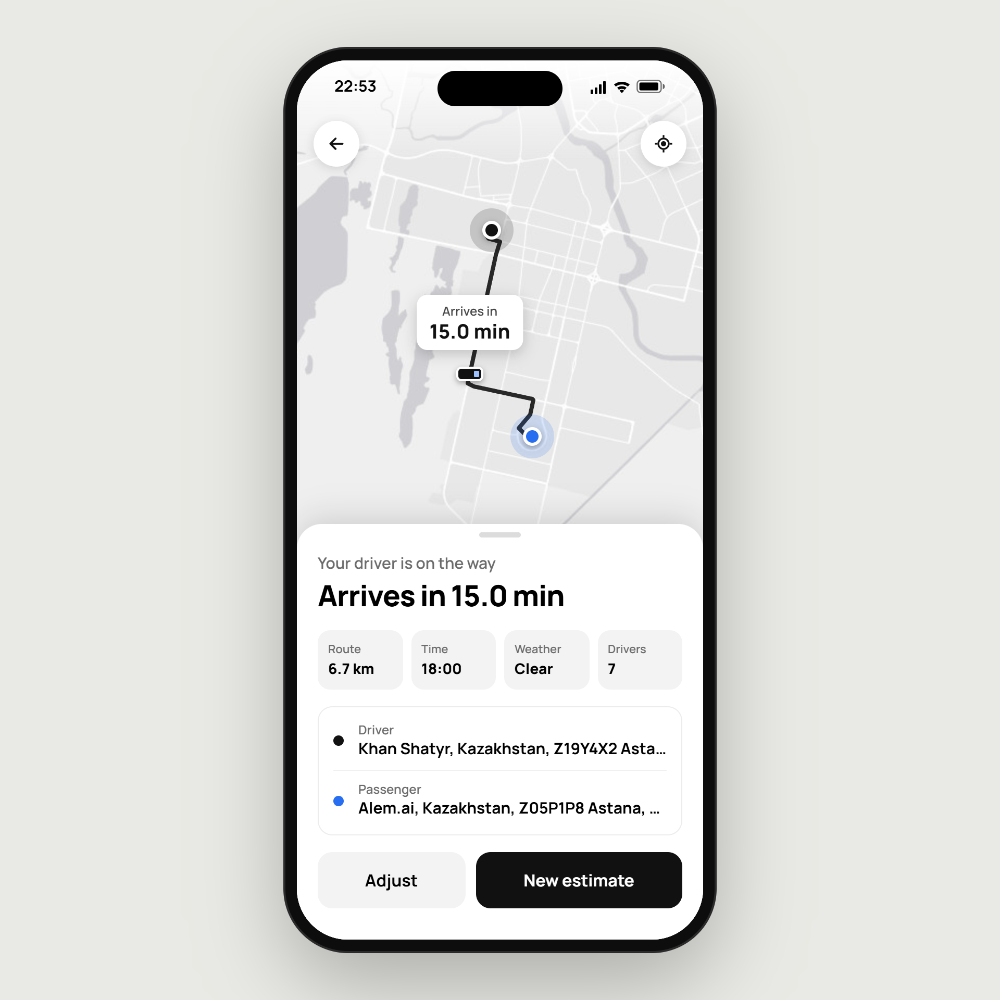

# Taxi Waiting-Time Predictor

An educational demo for MNU Machine Learning students. It shows how the course's first linear regression model can power a taxi waiting-time web app in Astana.

### ML

[Model notebook](server/taxi_app.ipynb) shows the first model from the course. It predicts waiting time from driving distance, nearby drivers, hour, and weather.

### Frontend

[Client](client/) uses React, Vite, Tailwind CSS, and Leaflet to choose locations, set trip conditions, and show the prediction. App: `URL`.

### Backend

[Server](server/) uses FastAPI, Geoapify, OpenWeather, and the saved model to calculate routes and predict waiting time. API: `URL`.

|  |  |
| :--------------------------------------------------------: | :------------------------------------------------------------: |
